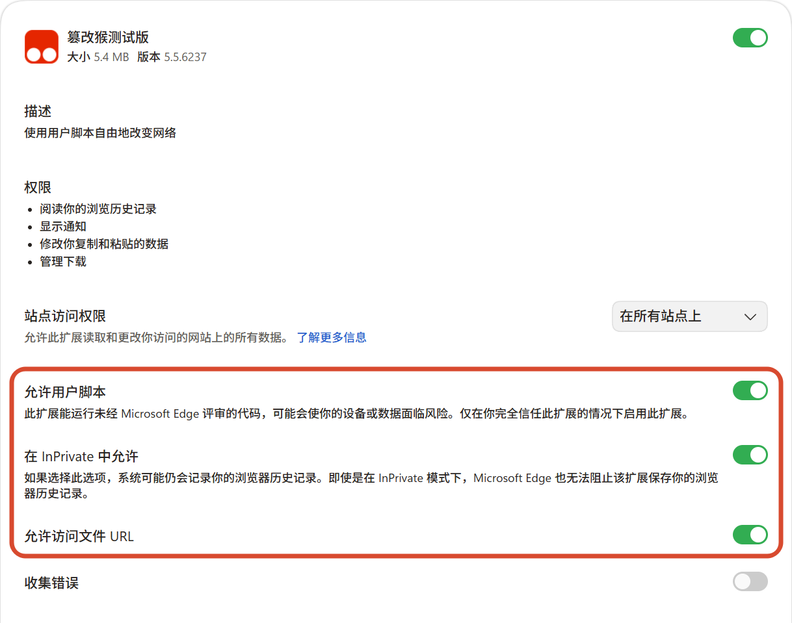

# 深圳大学成绩查询助手

## 项目介绍

深圳大学成绩查询助手是一个运行在 Tampermonkey 中的用户脚本，用于在深圳大学本科成绩查询页面获取和整合课程总成绩、平时成绩、期末成绩、成绩系数、GPA 与绩点排名。

本项目的成绩查询思路参考并受益于 [Matt-Dong123/tools4szu](https://github.com/Matt-Dong123/tools4szu) 项目。在此特别感谢原作者的探索与开源贡献；本项目在其思路基础上继续实现了成绩系数查询、数学模型回退、页面内详细表格、GPA 与排名趋势、交互优化和 Excel 导出等功能。

脚本复用浏览器当前已经登录的深大教务系统会话，不会在代码中保存账号、密码、Cookie 或 Token。它同时适配普通办事大厅入口和 WebVPN 入口。

当前版本：`4.23`。

如果这个项目对你有帮助，欢迎点一个 Star。

## 功能特点

- **一键查询详细成绩**：自动获取课程列表、平时成绩、期末成绩和成绩系数。
- **分层查询成绩系数**：优先轮询常见系数，再补充查询少见值；无法获得完整系数时使用数学模型回退。
- **两套结果界面**：保留悬浮窗卡片视图，并在官方页面中新增“详细成绩表格版”页签。
- **GPA 汇总与趋势**：展示总 GPA、学期 GPA、学年 GPA，以及学期和学年 GPA 趋势图。
- **绩点排名趋势**：展示学期和学年的相对排名趋势，并可查看实际排名和参与排名人数。
- **实时查询进度**：显示课程、系数和详细成绩的查询阶段与进度。
- **Excel 导出**：导出详细成绩及成绩系数来源。
- **安全便捷**：直接在已经登录的教务系统页面运行，无需额外后端服务。

## 详细成绩表格版

脚本会在官方成绩查询页面中新增一个名为“详细成绩表格版”的页签。该页签与悬浮窗共用同一份查询结果，不会重复维护另一套成绩请求逻辑。

### 表格字段

每个学期的详细成绩表格包含以下字段：

| 字段 | 说明 |
|---|---|
| 课程名称 | 课程名称，过长时自动换行 |
| 课程性质 | 将课程性质代码转换为“必修课”“选修课”等可读名称 |
| 学分 | 课程学分 |
| 总成绩 | 教务系统返回或脚本计算的课程总成绩 |
| 等级成绩 | 课程等级制成绩 |
| 平时成绩 | 查询得到的平时成绩 |
| 期末成绩 | 查询得到的期末成绩 |
| 平时成绩系数 | 平时成绩在课程总评中的系数 |
| 期末成绩系数 | 期末成绩在课程总评中的系数 |

### 表格排序

- 默认按课程名称升序排列。
- 点击一个新字段时，按该字段升序排列；再次点击同一字段时切换为降序。
- 每个学期内部独立排序，学期分组顺序保持不变。
- `N/A`、`?`、`-` 和“查询中”等未知值统一排在有效值之后。

### GPA 汇总和趋势图

表格顶部提供总 GPA、学期 GPA 汇总表、学年 GPA 汇总表，以及学期和学年 GPA 趋势图。趋势图支持鼠标悬停和键盘聚焦，选中数据点时会显示对应时间和准确 GPA，并淡化其他数据点。

### 学期和学年排名趋势

脚本通过成长记录中的绩点排名接口获取排名数据，并在 GPA 趋势图下方展示“学期排名趋势”和“学年排名趋势”。

- 排名图以相对排名为纵轴，相对排名数值越小，数据点越靠上。
- 数据点标签显示相对排名百分比。
- 悬停或键盘聚焦数据点时，会同时显示相对排名、实际名次和参与排名人数。
- 尚未生成排名的学期保持为空，不使用学年或其他学期的数据代填。
- 页面宽度充足时图表左右排列；在悬浮窗或窄屏环境下自动改为上下排列。

## 安装使用说明

### 前提条件

1. 安装浏览器扩展：
   - **Chrome**：安装 [Tampermonkey](https://chrome.google.com/webstore/detail/tampermonkey/dhdgffkkebhmkfjojejmpbldmpobfkfo)
   - **Firefox**：安装 [Greasemonkey](https://addons.mozilla.org/zh-CN/firefox/addon/greasemonkey/) 或 [Tampermonkey](https://addons.mozilla.org/zh-CN/firefox/addon/tampermonkey/)
   - **Edge**：安装 [Tampermonkey](https://microsoftedge.microsoft.com/addons/detail/篡改猴测试版/fcmfnpggmnlmfebfghbfnillijihnkoh?hl=zh-cn)

   > 扩展商店在部分网络环境下可能访问较慢，可能需要开启 VPN 才能获得较好的访问和下载速度。

2. 按照浏览器要求，同时开启 Tampermonkey 的用户脚本权限和浏览器扩展开发者模式。

   

3. 确保已登录深圳大学办事大厅：
   - 访问 [办事大厅](https://ehall.szu.edu.cn/new/index.html) 并打开“成绩查询”应用

### 安装步骤

1. 首次安装可以先观看[视频教程](https://www.xiaohongshu.com/discovery/item/6a631e50000000000301c729?source=webshare&xhsshare=pc_web&xsec_token=ABM99VBNRpBDh9lUZlYQATZSTYmDM2afNbcTEXbuYAhSg=&xsec_source=pc_share)。教程来自小红书博主 [czzzz](https://www.xiaohongshu.com/user/profile/6665a32c0000000003030583)，感谢博主制作和分享。
2. 通过 [Greasy Fork：深圳大学平时成绩 & 期末成绩查询](https://greasyfork.org/zh-CN/scripts/542686-%E6%B7%B1%E5%9C%B3%E5%A4%A7%E5%AD%A6%E5%B9%B3%E6%97%B6%E6%88%90%E7%BB%A9-%E6%9C%9F%E6%9C%AB%E6%88%90%E7%BB%A9%E6%9F%A5%E8%AF%A2)安装脚本。
3. 如果无法访问 Greasy Fork，可在 Tampermonkey 中选择“添加新脚本”。
4. 使用仓库中的 `main.js` 替换编辑器内的默认内容。
5. 保存脚本并刷新深大成绩查询页面。

### 使用流程

1. 登录并打开深圳大学成绩查询页面。
2. 点击页面右上角的“深大成绩”按钮，或打开官方页面中的“详细成绩表格版”页签。
3. 点击“开始查询”或“获取详细成绩”。
4. 等待进度条完成。查询过程中，页面内表格和悬浮窗会同步刷新。
5. 查询完成后，可以查看 GPA、排名趋势和各学期详细成绩，也可以导出 Excel。

## 工作原理

### 成绩和系数查询

1. 从成绩查询接口获取全部课程及官方总成绩。
2. 将平时成绩系数和期末成绩系数作为筛选条件，通过三轮分层查询反推出课程系数。
3. 对每个课程和字段执行唯一命中校验，避免接口忽略筛选条件时写入错误系数。
4. 并行扫描平时成绩和期末成绩，并按教学班 ID 合并到课程记录。
5. 对无法获得完整系数的课程使用数学模型回退，并用 `*` 标记推算结果。

如果平时系数和期末系数之和不等于 `100`，课程可能还包含期中、实验或实践等成绩项。此时脚本不会只用平时和期末成绩错误重算总成绩，而是保留教务系统返回的总成绩。

### 绩点排名查询

脚本从成长记录模块的排名接口按已有成绩学期获取：

| 范围 | GPA | 排名 | 相对排名 | 参与人数 |
|---|---|---|---|---|
| 学期 | `GPA` | `PM` | `XDPM` | `CYPMRS` |
| 学年 | `GPA` | `PM` | `XDPM` | `CYPMRS` |

排名请求与详细成绩查询并行执行。排名接口异常不会中断原有成绩查询；没有排名记录时显示为暂无数据。

## Excel 导出

Excel 成绩单包含课程基本信息、平时成绩、期末成绩、总成绩、成绩系数和系数来源。系数来源可能包括接口轮询、接口返回、数学模型推算和未知。用于界面标记推算结果的 `*` 不会混入数值字段，系数来源会单独保存。

## 注意事项

1. 脚本仅在深圳大学教务系统成绩查询页面生效：

   ```text
   https://ehall.szu.edu.cn/jwapp/sys/cjcx/*
   https://ehall-443.webvpn.szu.edu.cn/jwapp/sys/cjcx/*
   ```

2. 查询依赖浏览器当前登录会话。查询过程中请勿退出教务系统、清除 Cookie 或关闭页面。
3. 查询耗时取决于课程数量、系数命中轮次、网络环境和教务系统响应速度，不再是固定的请求次数或固定时长。
4. 部分课程尚未发布平时或期末成绩时，对应字段可能显示为暂无数据。
5. 排名数据由成长记录模块生成；最新学期可能暂时没有学期或学年排名。
6. 若请求频繁失败，可能是登录状态失效或教务系统限流，请刷新登录状态或稍后重试。

## 项目来源

本项目的成绩查询思路参考了 [Matt-Dong123/tools4szu](https://github.com/Matt-Dong123/tools4szu)，并在此基础上实现了成绩系数查询、数学模型回退、页面内详细表格、GPA 与排名趋势、交互优化和 Excel 导出。感谢原作者的技术贡献。
